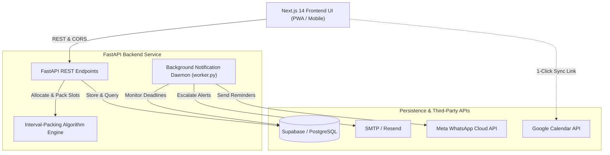

<div align="center">

# 📋 TaskMaster AI
### Autonomous Task Scheduler, Smart Resource Allocator & Tough-Love Accountability Engine

[](https://github.com/bijan-sarkar/task-master-app/actions/workflows/ci.yml)


<p align="center">
  A mobile-responsive, containerized application designed to fit weekly priorities into real daily free-time blocks using intelligent interval-packing algorithms, sync with Google Calendar, and send multi-channel tough-love accountability notifications (Email & WhatsApp).
</p>

</div>

---

## 🏗️ System Architecture



---

## ⚡ Key Engineering Features

1. **Intelligent Interval-Packing Slot Allocation**:
   - Define custom recurring weekly availability (e.g. Mon–Fri: 19:00–22:00, Weekends: 14:00–18:00).
   - An interval-packing algorithm fits tasks with estimated durations into your free windows without collision or double-booking.
2. **Google Summer of Code (GSoC) 5-Month Roadmap**:
   - Pre-loaded with a structured 51-task open-source curriculum spanning developer tooling, upstream PRs, mentor networking, and proposal drafting.
   - Synchronizes roadmap tasks directly into your calendar and free windows.
3. **Multi-Channel Tough Love Escalation Engine**:
   - Background worker monitors pending tasks and calculates time-to-deadline.
   - Escalates alerts from *Gentle* ➡️ *Firm* ➡️ *Harsh* ➡️ *Roast* to keep you accountable.
   - Dispatches via Gmail SMTP / Resend and Meta WhatsApp Cloud API.
4. **1-Click Google Calendar Synchronization**:
   - Generates instant Google Calendar integration links with pre-filled title, parameters, and localized UTC timeblocks.
5. **Containerized Architecture**:
   - Dockerized backend with multi-stage build optimization and `docker-compose` orchestration.

---

## 🚀 Quick Start (Local Development)

### Prerequisites
- Python 3.11+
- Node.js 18+ & npm
- Docker (Optional, for containerized run)

### 1. Backend Setup
```bash
cd task-manager-app/backend
python -m venv venv
source venv/bin/activate  # On Windows: venv\Scripts\activate
pip install -r requirements.txt
cp .env.example .env
uvicorn main:app --reload --port 8000
```

### 2. Frontend Setup
```bash
cd task-manager-app/frontend
npm install
npm run dev
```
Open [http://localhost:3000](http://localhost:3000) to view the dashboard.

### 3. Run Automated Tests
```bash
pytest task-manager-app/backend/tests
```

---

## 🐳 Running with Docker

```bash
cd task-manager-app
docker compose up --build
```

---

## 🛡️ DevOps & CI/CD

This repository enforces automated continuous integration via [GitHub Actions](.github/workflows/ci.yml):
* **Code Linting:** Static code analysis using `flake8`.
* **Automated Testing:** `pytest` test suite execution.
* **Container Validation:** Automated Docker build checks on every pull request and push to `main`.

---

## 📄 License

Distributed under the MIT License. See `LICENSE` for more information.
